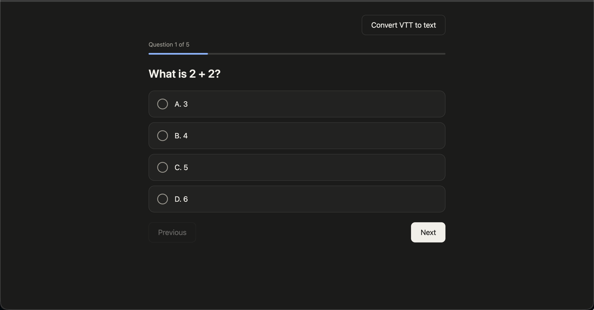
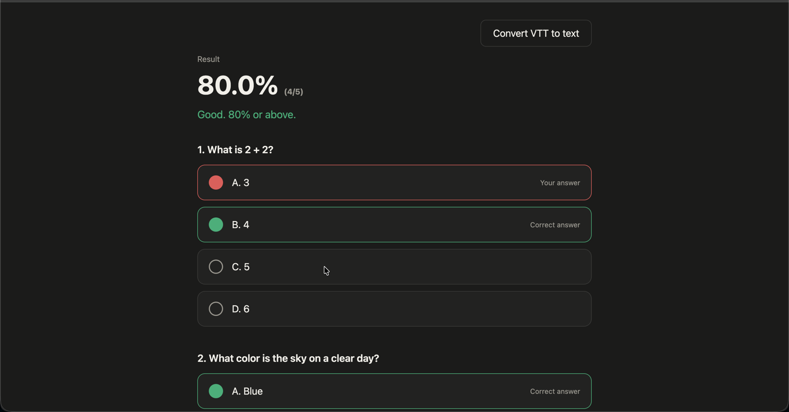

# Questions Web App
## What is the purpose of this web-app?
A personal web app that enables me to answer a series of MCQ questions from a json file.

## What it does
- Takes in a json file given to it through the code itself
- Enables one to answer questions given from the json in a clear and readable format
- Enables one to go back and forth from different questions
- Takes in all the answers at the end of the test
- Gives a percentage of the questions answered correctly  
- Outlines which questions were correct and incorrect 
- Tells the user:
  - **< 65%** Fail
  - **65% - 79%** Acceptable but could be better
  - **< 80%** Good

<p align="center">
  
  
</p>

## JSON Structure Example
**Note:** Answers are zero-indexed option numbers. Single-answer questions use
`answer` with one number. For multi-answer questions, use `answers` with a
non-empty list of option numbers; the learner must select exactly that set.
```json
[
  {
    "question": "What is 1+1?",
    "options": [
      "2",
      "3",
      "4",
      "5"
    ],
    "answer": 0
  },
  {
    "question": "Yellow mixed with blue makes what color?",
    "options": [
      "Purple",
      "Orange",
      "Green",
      "Brown"
    ],
    "answer": 2
  },
  {
    "question": "Which are Python collection types?",
    "options": ["list", "integer", "tuple", "float"],
    "answers": [0, 2]
  }
]
```

See [questions_bank/mixed_question_types_sample.json](questions_bank/mixed_question_types_sample.json)
for a small complete quiz containing both formats.